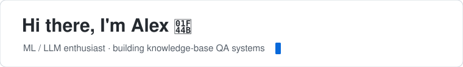
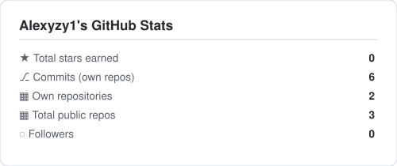
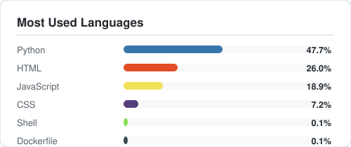

 

🎓 Undergraduate @ **CUHK-Shenzhen** · Exchange @ **UC Berkeley**

💡 Interested in machine learning, LLMs & retrieval-augmented systems

🌱 Recently exploring state-space models (Mamba)

 

## 🛠️ Tech Stack

 

## 📊 GitHub Stats

  
  

 

## 🚀 Featured Project

### [knowledge-base-qa](https://github.com/Alexyzy1/knowledge-base-qa)

Enterprise-grade **RAG** knowledge-base Q&A system — multi-format document parsing (PDF / Word / Excel / OCR / ASR), hybrid retrieval with reranking, multi-turn conversations, RBAC & sharing. Built with **FastAPI · Milvus · MySQL · DeepSeek/Qwen/OpenAI**.

  
  &nbsp;
  
  &nbsp;
  
  &nbsp;
  

 

---

⭐️ From [Alexyzy1](https://github.com/Alexyzy1)
